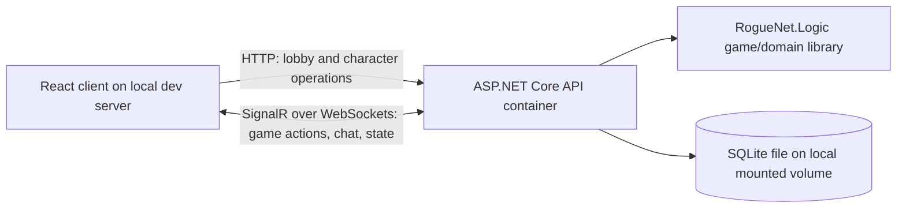

# RogueNet MVP Design Specification

**Status:** Working design proposal  
**Deployment target for MVP:** Local development and local play only  
**Future deployment constraint:** The ASP.NET Core API must be straightforward to run as a container; no cloud deployment is part of the MVP.

## 1. Product goal

Build a small, playable, browser-based multiplayer roguelike that combines classic grid movement and turn-based urgency with a first slice of persistent character progression and randomized equipment.

The MVP is successful when a player can create or select a local character, join a party, complete a short dungeon dive with up to three other players, extract or fail, and see the correct result reflected in the character record. The server is authoritative: clients send intentions and render server state; they do not decide movement, combat, loot, or saved progression.

The project already has a `RogueNet.Logic` library with an initial room-and-corridor generator and a console rendering demo. Treat those as useful prototypes: later stages should add tests and integrate the generator into the API rather than assume the prototype is production-ready.

## 2. MVP scope

### Included

- React browser client, usable on desktop and basic mobile-sized screens.
- ASP.NET Core API and game server, run locally as a container.
- One authoritative server process; one in-memory active-dive instance per party.
- Local display-name identity only; no external sign-in.
- Party creation/joining with a short room code, up to four players per party.
- Seeded room-first dungeon generation, connected rooms, corridors, doors, stairs, and a small set of decorations.
- Grid-based player movement and a small action set: move, interact/open/unlock, melee attack, defend, and wait.
- Round-based multiplayer input collection with a configurable deadline (default 30 seconds); missing actions resolve as wait.
- A small set of monsters, turn resolution, hit points, combat, death, and successful extraction.
- Adventure log showing action results and the important combat rolls/modifiers.
- SQLite persistence for local characters and their equipment/progression.
- A small randomized loot set with a few rarity levels and a limited number of equipment slots.
- Local API container build/run configuration with persistent SQLite storage mounted outside the container filesystem.

### Not included in the MVP

- Microsoft Entra ID/OAuth, public hosting, Azure resources, production operations, or multi-instance server scaling.
- Full talent/feat trees, spell preparation/casting, ranged combat, a large bestiary, bosses, or a broad item-affix catalog.
- Trading, matchmaking, public lobbies, leaderboards, moderation tooling, or spectating.
- A native terminal game client. The existing terminal demo remains a development aid.
- Advanced mobile-specific interaction design, custom themes, or extensive animation.
- Persisting an active dungeon dive across API restarts. Active dives are intentionally ephemeral in the MVP.

## 3. Player flow

1. Open the local web client and enter a display name.
2. Create a character or select a saved character.
3. Create a party or join one with a room code. The party host chooses the small set of MVP dive options, including difficulty and action-window length.
4. The host starts a dive. The server generates one seeded dungeon and places the party and monsters.
5. Players submit one action for each round. The server waits for all players or the deadline, treats missing actions as waits, resolves player actions and then monster actions, and broadcasts the resulting state.
6. Players reach the exit to extract, or the party fails when its players are defeated. The dive ends and its result is applied to character progression according to the reward policy below.
7. Players return to the character/party screen and can start another dive.

Chat is out-of-band: it does not submit an action, consume a turn, or extend the round deadline.

## 4. MVP gameplay rules

- The dungeon is a grid. Diagonal movement is allowed only if both destination and corner-cutting rules are explicitly tested; for the first playable slice, use cardinal movement if diagonal rules are not yet implemented.
- The server validates every action against the current game state. Invalid actions do not move actors or grant extra actions; the server returns a useful result in the adventure log.
- Opening a closed door or unlocking a locked door takes one action. For the MVP, unlocking does not require a key and always succeeds; this keeps generated routes traversable without adding key/lock progression.
- A round opens when the first valid player action is submitted. The deadline starts at that point. Each player may submit or replace their action until the round resolves; only their final valid selection is used.
- The round resolves when every living/active player has submitted or the deadline expires. A player who submitted no valid action waits.
- Resolve player actions in a stable party-seat order, rotating the first seat each round. Then resolve eligible monster actions in a stable order, update status/death/exit conditions, advance the round, and broadcast one authoritative snapshot.
- MVP movement and combat are intentionally small and deterministic apart from an injected seeded random source. Keep the initial formulas simple and visible in the adventure log; tune balance after playtests.
- A dive records its random seed so a generation or combat issue can be reproduced locally.
- Successful extraction commits that dive's XP and loot to the character. A failed dive commits no dive-only rewards; the saved character remains available and returns to the hub in a safe, usable state. This avoids partial-save rules in the first release.
- Keep the game engine independent of ASP.NET, SignalR, React, and EF Core. API, persistence, and transport code adapt requests to and from domain operations.

## 5. Local architecture and deployment

### Components

- **Client:** React with TypeScript, served by the local development server during development. Render map cells as structured glyph/color data in a monospace grid; do not inject raw ANSI escape sequences into HTML. A compact client view should include the map, player condition, available actions, action deadline/submission status, and adventure log. The minimap and detailed fog-of-war presentation may be completed in the final UI stage.
- **API/game server:** ASP.NET Core in the existing API project. Use HTTP for health, character, and party setup operations; use an ASP.NET Core SignalR hub using WebSockets for live game actions, chat, and state updates. Keep DTOs separate from domain models. The server owns validation, round timing, map state, combat, RNG, and persistence decisions.
- **Logic:** `RogueNet.Logic` contains map generation and game rules with no web or database dependencies. Add deterministic RNG injection and automated tests before relying on generated layouts in multiplayer.
- **Persistence:** SQLite through EF Core for character records and saved equipment/progression. Do not persist transient map/monster/player positions in the MVP.
- **Local container:** Add a multi-stage Dockerfile for the API and a local Compose definition. Bind the API only to localhost by default. Mount a host directory or named volume at the SQLite data path; never rely on the container writable layer for saved characters. The React development server may run on the host and connect to the mapped local API port.

### Operational constraints for MVP

- Run one API container/process. Active parties and dives are in memory and are lost if that process stops; saved character data survives through the mounted SQLite volume.
- Configure CORS and the SignalR endpoint for the local client origin only. No production secrets or public ingress are needed.
- Provide a health endpoint and container health check. Keep OpenAPI available in the local development environment.
- Document one-command local startup/shutdown and how to reset local test data. The exact command/file placement can be finalized during the container stage.

## 6. Staged delivery plan

Each stage is a small vertical slice with a visible demonstration. Do not start a later stage until the current stage builds, its acceptance checks pass, and the demo can be repeated from a clean checkout or documented local state.

### Stage 1 — Local API container and client shell

**Atomic deliverable:** A browser shell can reach a healthy API running in a container on the developer's machine.

- Add the API Dockerfile, local Compose configuration, health endpoint, local CORS policy, and SQLite mount configuration (the database can be unused at this stage).
- Scaffold the React client and show API connection status.
- Keep all ports bound for local use; document startup, shutdown, and health verification.

**Demonstration / acceptance:** Start the stack locally, open the client, and see an API-connected status. Stop the API and observe a clear disconnected status; restart it and recover without rebuilding the client.

### Stage 2 — Tested dungeon generation in the browser

**Status:** Implemented and verified locally with the API/client containers and seeded browser generation.

**Atomic deliverable:** The browser displays a server-generated dungeon using the existing Logic generator.

- Add unit tests for room bounds/buffers, map dimensions, connectivity graph, corridor reachability, wall boundaries, stairs, and reproducibility for a fixed seed.
- Expose a development endpoint to create a generated map and return a client-safe map DTO plus seed.
- Render terrain, rooms, corridor, door states, stairs, and decorations in a monospace ANSI-inspired palette.
- Keep map generation deterministic when a seed is supplied.

**Demonstration / acceptance:** Generate and refresh maps in the browser; supplying the same seed reproduces the same layout, and automated invariants pass.

### Stage 3 — Single-player movement and turn slice

**Atomic deliverable:** One local player can enter a generated dive and move around it through the browser.

- Add an in-memory dive state, player spawn, action DTO, server-side movement validation, and one-input/one-turn processing.
- Prevent movement through walls and map bounds; allow movement through open doors and floor. Add an interact action that opens closed doors and unlocks locked doors in one turn.
- Show current position and a concise action result in the client.
- Add domain tests for legal/illegal moves and ensure the client cannot directly mutate authoritative state.

**Demonstration / acceptance:** Walk a character around the seeded map; attempted movement into an obstruction leaves state unchanged and reports why. Open and unlock doors with an action, and verify the round/turn advances once.

### Stage 4 — Monsters, combat, and extraction

**Atomic deliverable:** A short solo dungeon has a complete start-to-finish gameplay loop.

- Add one or two monster types, simple movement/attack AI, hit points, melee attack, defend, death, and exit-stair extraction.
- Advance monster behavior only after a resolved player action/turn.
- Record the important hit/damage rolls and outcomes in a bounded adventure log.
- Keep balance values small and centralized; defer broad stat formulas.

**Demonstration / acceptance:** A player can encounter and defeat or avoid monsters, take damage, reach the exit, and see an unambiguous extraction result. Tests cover hit, miss, defense, damage, death, and extraction.

### Stage 5 — Party lobby and synchronized multiplayer rounds

**Atomic deliverable:** Two browser sessions can take part in the same authoritative dive without advancing the world independently.

- Add local display-name identity, party creation/join by code, host start, and a four-player party limit.
- Add the round coordinator, per-player final action slot, configurable deadline (default 30 seconds), wait-on-timeout behavior, stable/rotating resolution order, and one monster phase per resolved round.
- Send snapshots to all party members after resolution. Add out-of-band party chat that does not change the action deadline.
- Serialize mutations per party so simultaneous WebSocket calls cannot resolve the same round twice.
- Define disconnect behavior for MVP: a disconnected member waits after the deadline; the host may end a lobby before a dive starts. Rejoining a live dive is best-effort and must not create a second player.

**Demonstration / acceptance:** Open two clients, join one party, submit actions at different times, and verify the world waits for both or the deadline. Let one player time out and verify they hold position while the other player's action and monsters resolve exactly once.

### Stage 6 — Saved characters and local persistence

**Atomic deliverable:** A player can leave and return with a saved character record while active dive state remains ephemeral.

- Add EF Core SQLite schema/migrations for local player identity, character, base MVP stats, XP/level, and equipment references.
- Add character create/list/select operations; keep local display-name identity explicitly non-secure and local-only.
- Commit rewards only at the extraction/failure boundary defined above; make reward application idempotent so reconnect/retry cannot grant it twice.
- Use a mounted local SQLite file in the container and provide a documented reset path for development.

**Demonstration / acceptance:** Create a character, complete an extraction, restart the API container, and verify the character and saved rewards remain. Verify an unfinished dive is gone after restart and did not partially save dive rewards.

### Stage 7 — MVP loot and equipment

**Atomic deliverable:** Successful extraction can produce a small useful equipment upgrade visible on the character.

- Define a deliberately small equipment model (initially weapon and armor), a few item qualities, and a small number of stat modifiers.
- Generate loot from the dive seed, difficulty, and character level using testable rules; do not implement a large combinatorial affix system.
- Add inventory/equip/replace UI and server validation. Ensure equipment modifiers affect the same combat calculations shown in the adventure log.
- Save inventory and equipped item references only when rewards are committed.

**Demonstration / acceptance:** Complete dives at different difficulties, receive repeatable loot for a seed, equip an item, and observe its stat effect in the next combat. Invalid slot/equip requests are rejected server-side.

### Stage 8 — MVP usability and release check

**Atomic deliverable:** A local party can complete repeated dives through a coherent browser UI with enough information to make decisions.

- Add the player condition panel, action buttons/key bindings, round countdown/submission status, bounded adventure log with useful roll detail, and terrain-only minimap.
- Add basic explored-map behavior and actor visibility at the MVP sight range; do not reveal hidden monster/item state through DTOs.
- Ensure essential actions are usable by mouse and keyboard; use a stacked layout at narrow viewport widths.
- Add API/game integration tests for a complete party round and extraction reward commit; document local run, container rebuild, and data reset.
- Fix critical accessibility, reconnect, state serialization, and generated-map issues found in a short playtest.

**Demonstration / acceptance:** From a clean local start, two players can create/select characters, join a party, play a full dive, extract, restart the API, and confirm progression. The same flow remains usable at a phone-sized viewport.

## 7. MVP completion criteria

The MVP is done when all of the following are true:

- A clean local checkout can build and start the browser client and containerized API using documented steps.
- The API health check passes and saved data resides on a mounted local volume.
- Two to four local browser sessions can join and complete a shared dive with the round deadline and wait behavior functioning correctly.
- The server remains the sole authority for movement, turns, combat, map/monster state, loot, and progression.
- A completed extraction saves a character's MVP progression; API restart loses the active dive but not the saved character.
- Same-seed generation is reproducible, and the documented domain/integration tests pass.
- The core UI exposes the map, character condition, available actions, action window status, and action results without leaking unrevealed state.

## 8. Key risks and guardrails

- **Room/corridor generation can produce invalid or awkward maps:** add invariant tests and seeded regression cases before exposing the generator as a public API operation.
- **Turn races can duplicate actions or rewards:** serialize per-party transitions, identify each round/action, and make round resolution and reward commit idempotent.
- **Container restarts lose in-memory dives:** make this explicit in the local UI/documentation; persist only characters and extracted progression for MVP.
- **SQLite inside containers can silently lose data:** require a mounted data path and test persistence through a container restart.
- **Feature scope can overwhelm a small MVP:** defer OAuth, spells, talents, advanced item affixes, and cloud hosting until the local multiplayer vertical slice is fun and stable.
- **Hidden state can leak through broad snapshots:** build player-specific view DTOs for fog-of-war; never send hidden actors/items and rely on CSS to hide them.

## 9. After MVP

Potential follow-on work includes Entra ID/MSAL authentication, cloud hosting, multi-instance coordination, a richer class/talent/spell system, ranged combat, deeper item generation, larger bestiary/bosses, true terminal client, jagged/wide corridors, party management, and production persistence/backup strategy. These are explicitly not prerequisites for the local MVP.
